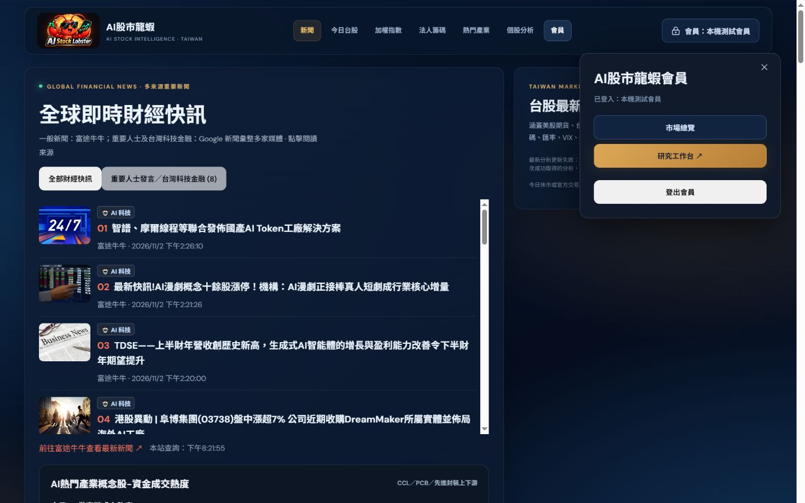
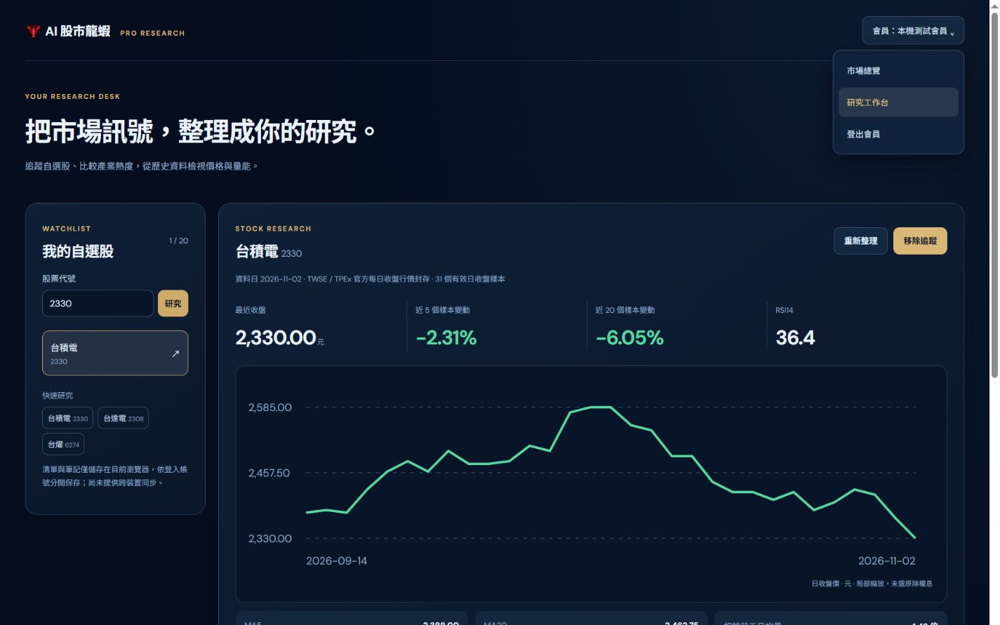
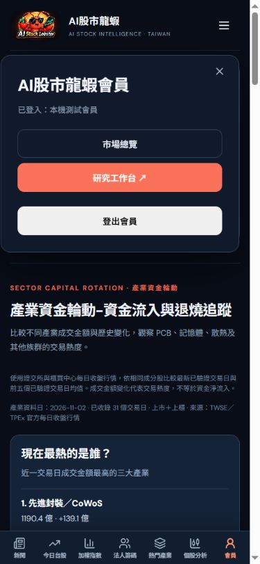

# 會員工作台入口整理

- 移除首頁公共區域的 Pro 研究工作台大型宣傳卡片。
- 桌面導覽「會員」、右上會員按鈕與手機底部「會員」集中開啟原有會員面板。
- 已登入面板提供「市場總覽」「研究工作台」「登出會員」，管理者仍保留後台入口。未登入面板保留原有登入方式，不顯示工作台捷徑。
- `/pro` 右上加入會員選單，提供相同切換及登出操作。頁面與 API 的會員保護不變。
- 修正會員面板層級，確保位於固定導覽上方，長內容可在面板內捲動。

驗證：Next.js 正式建置與型別檢查通過。以本機合成測試 session 實測桌面會員入口 → 工作台 → 市場總覽；390px 手機會員按鈕可開啟面板，頁面沒有橫向溢出。首頁已無 `.membership` 宣傳區塊或失效的 `#membership` 會員連結。登出沿用原有 NextAuth `signOut({callbackUrl:"/"})`，未操作真實會員帳號登出。

