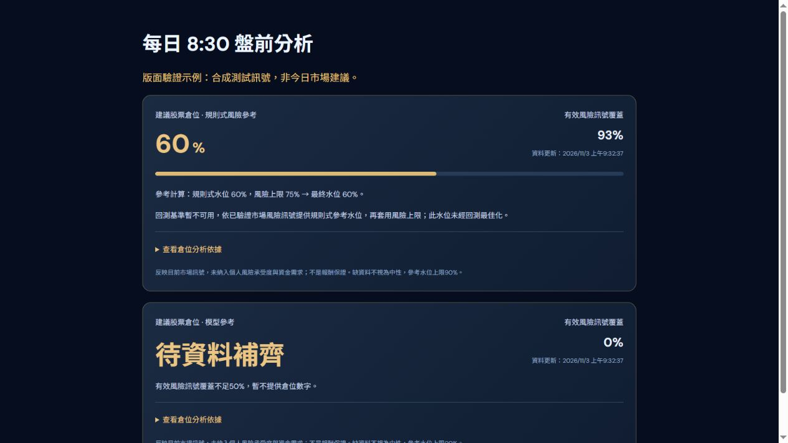
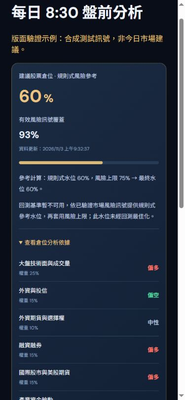

# 盤前名稱與倉位水位分析

名稱改回「每日 8:30 盤前分析」。保留目前 `view=live` 更新方式，畫面明示這是依最新已公布資料更新，並非固定 8:30 封存快照；不更動盤前封存排程或回寫歷史命中率。

## 倉位計算

原先必須同時有回測基準與至少50%有效訊號覆蓋，才提供數字；回測來源失效時，即使風險訊號足夠仍永久空白。

現在優先沿用動能回測基準及既有風險上限；回測基準不可用但有效訊號權重覆蓋至少50%時，改採**明示且未經回測校準的規則式參考**：風險分數 ≥75／60／45／30／低於30，分別對應股票水位75／60／45／30／20%，再套用既有風險上限。覆蓋50%～74%最高50%，整體最高90%。覆蓋不足50%仍不提供數字，缺值不當成中性，回測基準0%會保留為0%。

這是站內市場風險模型，不是個人化配置或經最佳化驗證的投資策略。個人配置仍涉及風險承受度、時間範圍及資金需求，參考 [Investor.gov 的資產配置說明](https://www.investor.gov/introduction-investing/getting-started/asset-allocation)。

## 顯示

新增倉位分析卡：百分比、訊號覆蓋率、更新時間、水位基準與風險上限的計算過程、各因子權重與方向、回測狀態。既有分析小總結也會使用同一個計算結果，避免兩套水位互相矛盾。

## 驗證

- Next.js 正式建置及型別檢查通過。
- 74項測試通過：新增4項測試涵蓋無回測但覆蓋足夠、低覆蓋不硬填、部分覆蓋上限、0%保留、NaN拒絕及多空方向差異；既有封存不可改寫測試持續通過。
- 桌面與390px手機檢查百分比、展開因子、缺資料畫面；手機無橫向溢出。
- 下列截圖為正式元件搭配**合成測試訊號**的畫面驗證，非今日實際水位，不代表已取得登入會員的即時分析。

