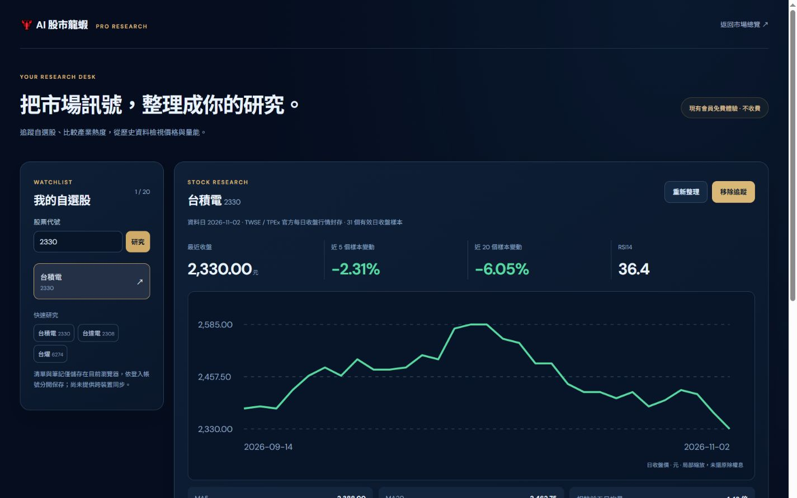
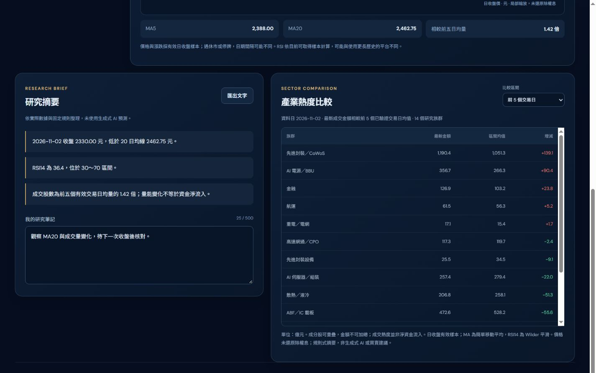
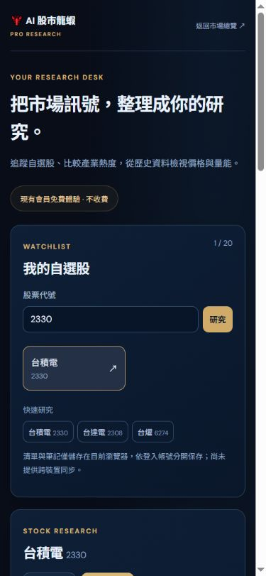

# Pro 研究工作台：現有會員免費體驗

## 開放方式

入口為 `/pro`，首頁會員區新增直接連結。現有登入會員皆可使用，不建立付費資格、不收款、不要求付款資料。未登入者看到功能介紹及登入入口。沿用 NextAuth v4 既有驗證，頁面與 `/api/pro/research` 均在伺服器檢查 session；API 回傳 `private, no-store` 並依 Cookie 區分，匿名請求在取得資料前即回傳 401。

## 第一版功能

- 自選股最多 20 檔，四碼代號查詢、快速研究、加入／移除、每檔 500 字筆記。儲存於目前瀏覽器，依伺服器產生的帳號雜湊分隔；無跨裝置同步，清除瀏覽器資料即會移除。無法儲存時提示使用者。
- 個股有效日收盤走勢、5／20 個樣本變動、MA5／MA20、RSI14、相較前五日均量。優先使用已驗證 TWSE／TPEx 官方封存；不在研究清單內的股票嘗試 Yahoo Finance 日資料，標示非官方與可能延遲。無資料時不製造數字。
- 14 個固定研究族群的 5／10／20 個已驗證交易日比較，按「最新成交金額－前 N 日均值」排序；相同成分股缺資料就不提供比較。非官方產業指數，成分可能重疊。
- 研究摘要以明示規則整理均線、RSI、量能，非生成式 AI、非預測或買賣建議。可匯出包含來源、資料日、計算摘要與個人筆記的純文字檔。

## 資料口徑

盤中排除尚未收盤的當日價格。價格未還原除權息，不將價格乘成交量當作成交金額。RSI14 採 Wilder 平滑，但只使用目前取得的有效收盤樣本，可能與載入更長歷史的平台不同。畫面會標示樣本數與實際資料日期；停牌或缺資料可能使日期間隔不同。沒有宣稱即時串流、雲端自選同步、交易提醒、完整歷史回測或生成式 AI 分析已完成。

參考：[NextAuth 伺服器 session](https://next-auth.js.org/configuration/nextjs)、[RSI 計算方法](https://chartschool.stockcharts.com/table-of-contents/technical-indicators-and-overlays/technical-indicators/relative-strength-index-rsi)。

## 驗證

- Next.js 正式建置與型別檢查通過，70 項測試通過（新增 8 項）。
- 預覽環境缺少 NEXTAUTH_SECRET 時，功能介紹頁顯示驗證服務提示、API 回傳 503；不提供驗證旁路、不影響正式環境既有設定。
- 涵蓋匿名拒絕、一般會員免費存取、非法查詢、私有快取標頭、指標暖機、未來／盤中資料排除、缺樣本、自選清單容量與損壞資料、官方斷線備援、產業比較分母及摘要匯出。
- 本機正式服務：匿名 API 401，已登入測試 session API 200，台燿 6274 可取得指標與 14 個產業比較，20 日區間可切換。
- 瀏覽器實測加入自選、筆記編輯、重新整理保存、切換上市／上櫃個股、產業區間、匯出文字。
- 桌面 1440px 與手機 390px 已檢查，文件沒有橫向溢出；未登入頁面僅顯示功能介紹及登入入口。
- 登入畫面測試使用僅綁定 loopback 的暫時代理與合成 NextAuth 測試 session；隨機測試密鑰只留於記憶體。未修改正式驗證、未建立真實會員或公開測試帳號，測試代理不納入版本。

## 後續範圍

雲端同步、推播提醒、生成式研究報告、更多個股歷史與回測，可各自作為後續功能。收費與訂閱需要另外確認價格、金流及權限生命週期；本版本不啟用。

