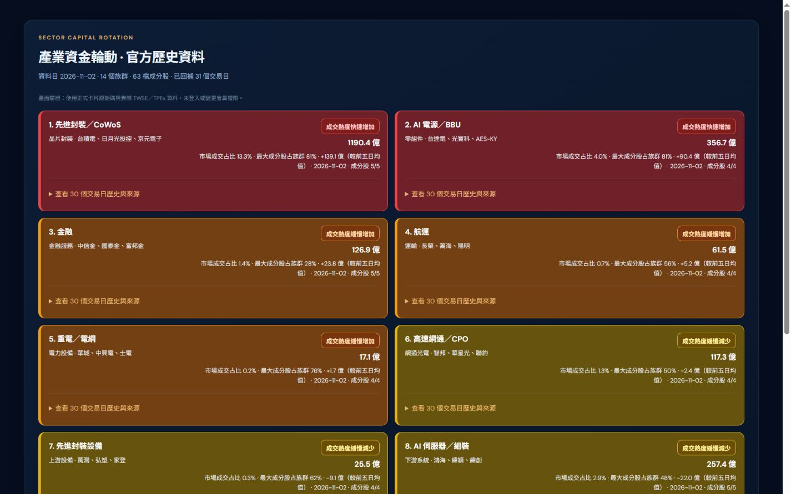
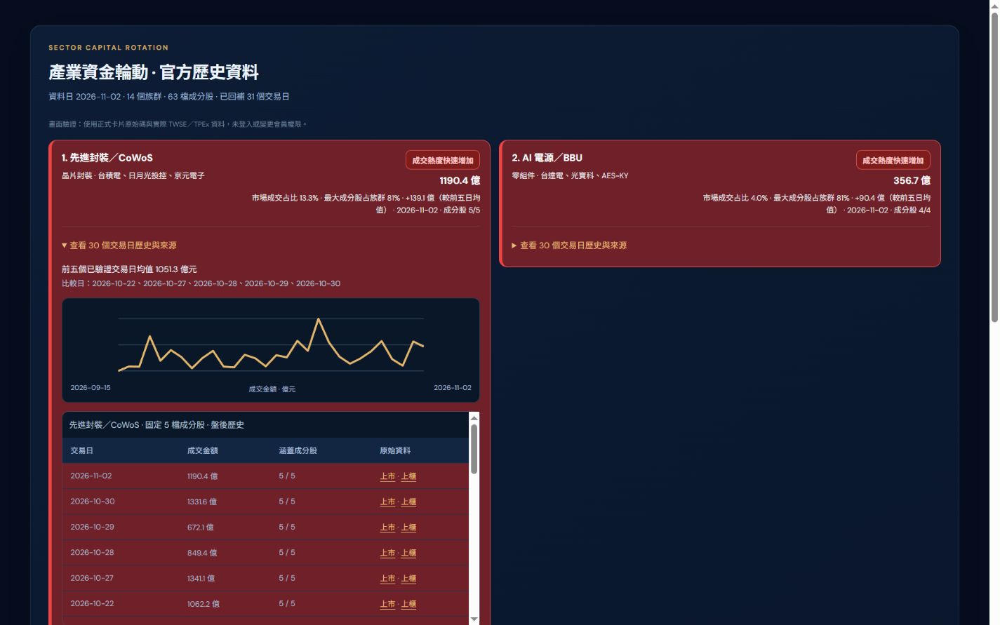
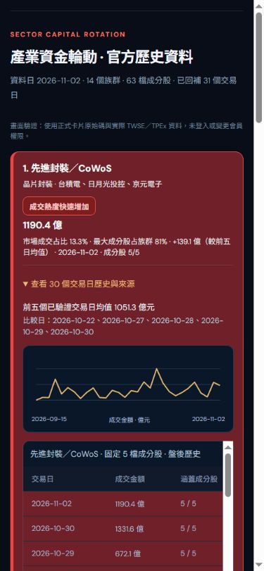

# 產業歷史資料修正

## 原因與修正

原解析器只讀 `fieldsN/dataN`，漏讀證交所現行 `tables[]` 格式；族群含上櫃成分股，卻只下載上市歷史；4.5 秒的整批逾時又可能捨棄所有結果。即使網路上有資料，所有族群仍可能永久顯示「資料不足」。

現在使用 TWSE 與 TPEx 官方每日收盤行情，核對回傳交易日期、表頭與成交金額單位，再依原有固定研究族群彙總。31 個交易日（2026-09-14 至 2026-11-02）、63 檔成分股已實際回補，14 個族群全部可計算前五個已驗證交易日均值。查詢失敗不會被標記為零成交。

最新金額與歷史比較均使用同一組上市＋上櫃成分股。新增完整涵蓋數、比較日、最新資料日、30 日圖表、每日表格及逐日官方原始資料連結。各族群是本站研究清單，非交易所官方產業指數，也非全產業完整成分股；族群成分可能重疊，成交金額代表交易熱度而非淨資金流入。

## 來源

- [TWSE 每日收盤行情](https://www.twse.com.tw/zh/trading/historical/mi-index.html)：指定日期的上市個股成交金額（元）、成交股數、收盤價。
- [TPEx 每日收盤行情](https://www.tpex.org.tw/www/zh-tw/afterTrading/dailyQuotes?response=json&date=2026/11/02)：指定日期的上櫃個股成交金額（元）、成交股數、收盤價。
- 本次官方原始回應已實際核對，不用搜尋摘要、成交價乘成交量估值、舊瀏覽器快照或外部業者分類指數替代。

## 更新與失敗處理

`backfill-sector-history.cjs` 可重跑，最多三日同時請求，保留最近 35 個已驗證交易日；現有每日封存排程先更新官方逐股歷史再儲存族群摘要。API 查詢新交易日並使用隨部署攜帶的官方歷史備援，短暫斷線不需從零重新累積。最新排行與交易日曆失敗也不會抹去已驗證產業歷史。

資料來源落後時明確標示實際日期；不使用缺少成分股的資料計算增減。每日排程需成功執行與提交，長期排程停擺仍可能造成封存落後；畫面保留日期與落後提示。

## 驗證

- Next.js 正式建置及型別檢查通過，62 項測試通過。
- 新增測試涵蓋新舊格式、上市上櫃混合族群、資料日期、缺股／缺市場、前五日平均、未來日期排除、零成交、真實封存涵蓋率、全來源斷線備援。
- 本機正式 API：HTTP 200、31 個交易日、14 個族群均為 `verified`，各族群有 30 日明細。
- 桌面 1440px 與手機 390px 的卡片、展開明細、表格滾動已檢查。手機文件沒有橫向溢出，明細表在自己的容器內捲動。
- 截圖採用正式卡片原始碼及實際官方回補資料的本機畫面驗證頁。未登入正式會員帳號，也未修改驗證或會員權限；登入後完整頁面仍需在預覽站驗收。

